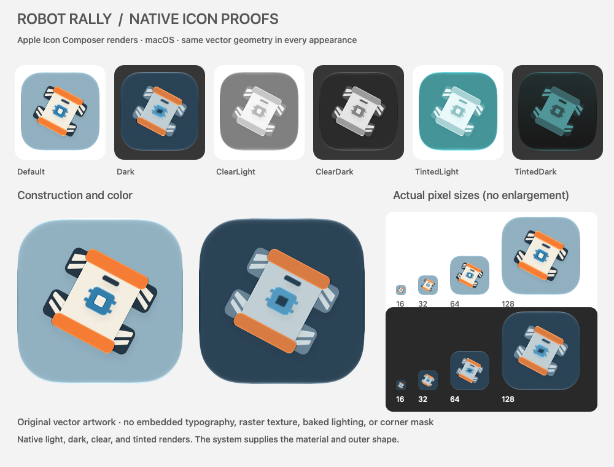

# Robot Rally app icon

The production icon is a compact competition rover viewed from above, turned 28° toward the upper right. Orange bumpers, mirrored mecanum rollers, and a central control board connect it to the robot in the game. Its blue-gray tile carries the app's workshop palette into Finder and the Dock.

## Design basis

Reviewed on November 22, 2026:

- [Apple Human Interface Guidelines: App icons](https://developer.apple.com/design/human-interface-guidelines/app-icons/)
- [Apple Design Resources](https://developer.apple.com/design/resources/)
- [Creating your app icon using Icon Composer](https://developer.apple.com/documentation/xcode/creating-your-app-icon-using-icon-composer)

Apple does not publish a numeric icon-quality certification. The following is a **self-assessment**, using a project rubric derived from that guidance. It is not an Apple score or endorsement. Aesthetic reception remains subjective.

## Review: 9.1 / 10

| Criterion | Score | Evidence and judgment |
| --- | ---: | --- |
| Clear purpose and recognizable subject | 18 / 20 | The four roller wheels, paired bumpers, front sensor, and control board read as a competition rover. An educational symbol is deliberately omitted to keep one subject. |
| Small-size recognition | 17 / 20 | Inspected native 16, 32, 64, and 128 px exports on light and dark backdrops. The diagonal footprint and orange bumper pair persist. At 16 px, the control-board core and roller details become accents rather than individually legible parts. |
| Native construction and clean edges | 15 / 15 | Seven SVG layers in three Icon Composer groups; 1024-square canvases; no raster imagery, text, embedded gradients, shadows, or outer corner mask. Apple renders the materials and final silhouette. |
| Appearance consistency | 14 / 15 | Default, dark, clear light/dark, and tinted light/dark were exported by Apple's renderer. All share identical geometry. Dark uses subdued body colors and lighter tires. Dark tint is intentionally quieter and has less color separation. |
| Composition and cropping | 10 / 10 | Shared rotation and center for every component. The rover fits comfortably inside the system mask without clipped wheels or bumpers. The front sensor gives direction without a separate arrow. |
| Originality and restraint | 8 / 10 | Custom geometric artwork rather than a stock robot face, mascot, screenshot, or symbol collage. The rover/microcontroller metaphor is familiar, so distinctiveness comes from its exact stance, roller pattern, and bumper proportions. No trademark-distinctiveness claim is made. |
| Fit with Robot Rally | 9 / 10 | Orange competition bumpers and mecanum wheels match the game's rover; the restrained steel-blue/ivory palette fits the native app. It does not reproduce the detailed in-game sprite. |
| **Total** | **91 / 100** | **Meets the requested 9 / 10 project target.** |

## Iteration record

1. Generated a flat rover concept. Rejected: elongated car-like silhouette and a large windshield-like blue area.
2. Generated a shorter concept. Rejected for production: inconsistent roller directions and an electronics module that did not share the chassis rotation.
3. Rebuilt the artwork in SVG using shared coordinates and one rotation. Corrected the Icon Composer group order after the first native render hid the control module.
4. Replaced the initial center module with a microcontroller shape, eliminating an unintended character-like silhouette. Split color components into editable vector layers, adjusted dark-mode contrast, and let the system supply restrained highlights.
5. Inspected the six native appearances and actual-size proofs. Inspected Xcode's compiled ICNS fallback and asset catalog metadata, including vector renditions and light/dark/tintable image stacks.

## Source and reproduction

- `../RobotRally/AppIcon.icon/` is the production Icon Composer document.
- `rover-master.svg` is the unmasked flat master, not an app screenshot or a finished system rendering.
- `build-icon.py` reproduces the SVG layers and appearance configuration. It overwrites the generated files in this icon bundle; edit the script when changing geometry.
- `export-icon.sh OUTPUT_DIRECTORY` exports the six appearances with Apple's `ictool` and builds a comparison sheet. Run with Xcode 27 selected.

The project sets `ASSETCATALOG_COMPILER_APPICON_NAME = AppIcon`. Xcode compiles both the layered catalog and an `AppIcon.icns` compatibility resource. The app still targets macOS 14. The in-app theme preference does not control the system's Dock/Finder icon appearance.

The exploratory prompts are preserved in [concept-prompts.md](concept-prompts.md).

## Authorship

Codex produced the concept prompts and final vector artwork. OpenAI's built-in ImageGen produced two exploratory raster concepts; neither raster is shipped in this icon. The final production art is generated from the editable geometry in `build-icon.py`. Apple supplies the native renderer, mask, and materials. The file format was checked against Xcode's bundled macOS Icon Composer template and Apple's Landmarks sample; no Landmarks artwork was reused. Retain this AI-assistance disclosure for any Student Challenge submission.
